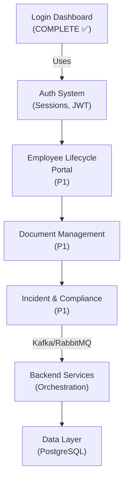
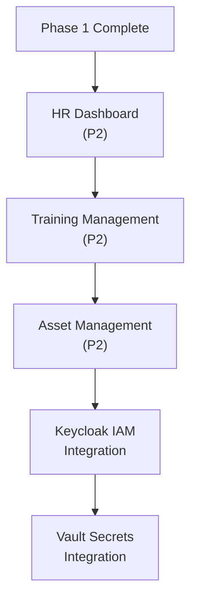
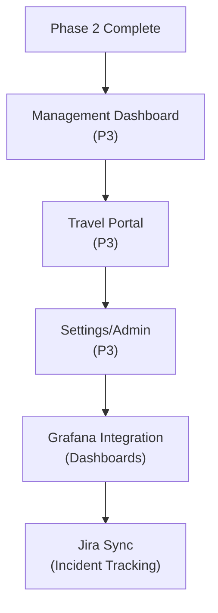

# EHS Software UI Requirements & Development Roadmap

## 📋 Executive Summary

Based on the **Enterprise EHS AI Architecture** and current project status, this document outlines:
- Current UI Implementation Status
- Pending UI Modules (Priority 1-3)
- UI Architecture Alignment
- Development Roadmap with Mermaid Diagrams

---

## 🏗️ Enterprise Architecture Overview

### Reference Architecture Layers

```
┌─────────────────────────────────────────────────────────────────┐
│                    PRESENTATION LAYER                            │
│  Employee Portal │ HR Dashboard │ EHS Dashboard │ Mgmt Dashboard │
└────────────────────────────┬────────────────────────────────────┘
                             │
┌────────────────────────────▼────────────────────────────────────┐
│              ORCHESTRATION & SERVICES LAYER                      │
│  Employee Lifecycle │ Document Mgmt │ Incident & Compliance │   │
│                    ← Kafka/RabbitMQ →                            │
└────────────────────────────┬────────────────────────────────────┘
                             │
┌────────────────────────────▼────────────────────────────────────┐
│               AI & AUTOMATION LAYER                              │
│  OCR │ NLP │ Claude AI │ LangChain │ Predictflow Alerts          │
└────────────────────────────┬────────────────────────────────────┘
                             │
┌────────────────────────────▼────────────────────────────────────┐
│            DATA & SECURITY LAYER                                 │
│  Keycloak IAM │ HashiCorp Vault │ PostgreSQL │ MinIO Docs        │
└────────────────────────────┬────────────────────────────────────┘
                             │
┌────────────────────────────▼────────────────────────────────────┐
│        MONITORING & INTEGRATION LAYER                            │
│  ELK/OpenSearch │ Grafana/Metabase │ Jira Integration           │
└─────────────────────────────────────────────────────────────────┘
```

---

## ✅ COMPLETED UI MODULES

### 1. **Authentication System** ✓
| Feature | Status | Files |
|---------|--------|-------|
| Login Page | ✅ Complete | `index.html`, `script.js` |
| Signup Page | ✅ Complete | `signup.html`, `signup.js` |
| Forgot Password | ✅ Complete | `forgot-password.html`, `forgot-password.js` |
| Session Management | ✅ Complete | JWT + localStorage |
| MFA Prep (Keycloak) | 🔄 Backend Ready | See Data & Security Layer |

**Current Features:**
- Email/password validation
- Demo credentials (demo@ehssuite.com / Demo@123456)
- "Remember me" functionality
- Real-time error messages
- Loading states & spinners
- Responsive design (all devices)

**Security Features:**
- Client-side validation
- Password strength requirements
- Session timeout
- Logout functionality

---

### 2. **EHS Dashboard** ✓ (PARTIALLY COMPLETE)
| Feature | Status | Files |
|---------|--------|-------|
| Sidebar Navigation | ✅ Complete | `dashboard.html`, `dashboard.js`, `dashboard.css` |
| Menu Categories | ✅ Complete | 6 categories with 14+ items |
| Statistics Cards | ✅ Complete | 4 KPIs displayed |
| Compliance Progress | ✅ Complete | Visual bar + percentage |
| Status Alerts | ✅ Complete | Warning/Info/Success |
| User Profile Dropdown | ✅ Complete | Profile + Logout |
| Mobile Responsiveness | ✅ Complete | All breakpoints |

**Current Statistics:**
- PTW/SSRA Compliance: 87.3%
- Incident Reports: 5
- Certificates: 8
- Equipment Status: 2

**Current Menu Structure:**
```
📊 Overview
   ├─ My Dashboard
   └─ Compliance Dashboard

🔧 Daily Operations
   ├─ PTW/SSRA
   └─ Incident Reports

✅ Compliance
   ├─ Certificate Repository
   └─ Deployment Readiness

🛟 Assets
   ├─ PPE & Equipment
   └─ Calibration Tracker

📈 Performance
   ├─ EHS Scorecard
   └─ Document Repository

👥 HR & Admin
   ├─ Training
   └─ Employee Management

⚙️ System
   └─ Settings
```

---

## 🔴 PENDING UI MODULES (HIGH PRIORITY)

### **TIER 1: Critical (Week 1-2)**

#### 1. **Employee Lifecycle Management Portal**
**Business Process:** Employee onboarding, training, compliance tracking

| Component | Description | Priority |
|-----------|-------------|----------|
| **Employee Directory** | Search, filter, view profiles | 🔴 P1 |
| **Onboarding Wizard** | 5-step onboarding flow | 🔴 P1 |
| **Training Dashboard** | Training history, certifications | 🔴 P1 |
| **Compliance Status** | Individual employee compliance checklist | 🔴 P1 |
| **Performance Analytics** | Employee safety scores, KPIs | 🔴 P1 |

**UI Requirements:**
```
Employee Lifecycle Portal Layout:
┌─────────────────────────────────────┐
│ Search & Filter Bar (Name, Dept, Status)
├─────────────────────────────────────┤
│ [Card 1]  [Card 2]  [Card 3]        │
│ Employee  Employee  Employee        │
│ Profile   Profile   Profile         │
├─────────────────────────────────────┤
│ Quick Actions:                      │
│ [Assign Training] [View Compliance] │
│ [Print ID Card]   [Generate Report] │
└─────────────────────────────────────┘
```

**Key Features to Implement:**
- Search with real-time filtering
- Employee cards with status badges
- Quick action buttons
- Bulk operations (assign training, send notices)
- Export to PDF/Excel
- Department filters
- Status indicators (Active, On Leave, Terminated)

---

#### 2. **Document Management Portal**
**Business Process:** Upload, organize, retrieve EHS documents

| Component | Description | Priority |
|-----------|-------------|----------|
| **Document Repository** | Categorized document storage | 🔴 P1 |
| **Upload Interface** | Drag-drop, progress, validation | 🔴 P1 |
| **Document Search** | Full-text search with filters | 🔴 P1 |
| **Version Control** | Document versioning, audit trail | 🔴 P1 |
| **OCR Integration UI** | Upload + auto-text extraction | 🔴 P1 |

**UI Requirements:**
```
Document Management Portal:
┌──────────────────────────────────────┐
│ [📁 Upload] [🔍 Search] [📊 Filter]  │
├──────────────────────────────────────┤
│ ┌─────────────────────────────────┐  │
│ │ Drag files here or click to...   │  │
│ │  ✓ Safety Policies              │  │
│ │  ✓ Incident Reports             │  │
│ │  ✓ Certifications               │  │
│ │  ✓ Audits                       │  │
│ └─────────────────────────────────┘  │
├──────────────────────────────────────┤
│ 📄 Document List (Table)             │
│ Name│Uploaded│Type│Status│Actions   │
└──────────────────────────────────────┘
```

**Advanced Features:**
- OCR-extracted content display
- Document preview (PDF, images, text)
- Version timeline
- Access control per document
- Retention policies
- AutoML categorization

---

#### 3. **Incident & Compliance Management**
**Business Process:** Report, track, and resolve safety incidents

| Component | Description | Priority |
|-----------|-------------|----------|
| **Incident Reporting Form** | Multi-step incident report creation | 🔴 P1 |
| **Incident Dashboard** | Real-time incident tracking | 🔴 P1 |
| **Compliance Checklist** | Daily/weekly compliance verification | 🔴 P1 |
| **Alert System** | Real-time notifications for violations | 🔴 P1 |
| **Investigation Form** | Root cause analysis workflow | 🔴 P1 |

**UI Requirements:**
```
Incident Dashboard:
┌────────────────────────────────────────┐
│ [+ Report Incident] [Filter] [Export]  │
├────────────────────────────────────────┤
│ Critical (2) │ High (5) │ Medium (8)   │
├────────────────────────────────────────┤
│ Card-based incident display:           │
│ ┌─────────────────────────────────┐    │
│ │ 🔴 Critical: Equipment Failure  │    │
│ │ Dept: Manufacturing             │    │
│ │ Date: 2026-10-27 14:30         │    │
│ │ Status: [Investigation]         │    │
│ │ [View] [Update] [Close]         │    │
│ └─────────────────────────────────┘    │
└────────────────────────────────────────┘
```

**Key Features:**
- Real-time severity color coding
- Incident timeline view
- Responsible person assignment
- Due date tracking
- Automated escalation
- Email notifications

---

### **TIER 2: Important (Week 3-4)**

#### 4. **HR Dashboard**
**Business Process:** HR operations, leave management, training administration

| Component | Description | Priority |
|-----------|-------------|----------|
| **Leave Management** | Request, approve, track leaves | 🟠 P2 |
| **Attendance Tracking** | Real-time attendance display | 🟠 P2 |
| **Payroll Integration** | Link to payroll system | 🟠 P2 |
| **Performance Metrics** | Employee performance scores | 🟠 P2 |

**UI Features:**
- Calendar view for leave planning
- Approval workflow UI
- Attendance heatmap
- Performance trend charts

---

#### 5. **Training & Certification Management**
**Business Process:** Assign and track employee training

| Component | Description | Priority |
|-----------|-------------|----------|
| **Training Catalog** | Available courses database | 🟠 P2 |
| **Course Assignment** | Bulk and individual assignment | 🟠 P2 |
| **Progress Tracking** | Completion status dashboard | 🟠 P2 |
| **Certification Expiry** | Alerts for expiring certifications | 🟠 P2 |

**UI Features:**
- Course cards with metadata
- Progress bars per employee
- Expiry countdown badges
- Completion certificates

---

#### 6. **Asset & Equipment Management**
**Business Process:** Track PPE, equipment maintenance, and calibration

| Component | Description | Priority |
|-----------|-------------|----------|
| **Equipment Inventory** | Complete equipment list | 🟠 P2 |
| **Maintenance Schedule** | Preventive maintenance tracking | 🟠 P2 |
| **Calibration Tracker** | Equipment calibration status | 🟠 P2 |
| **PPE Distribution** | Track PPE assignments to employees | 🟠 P2 |

**UI Features:**
- Equipment cards with QR codes
- Maintenance timeline
- Status indicators (OK, Due, Overdue)
- Bulk operations

---

### **TIER 3: Enhancement (Week 5-6)**

#### 7. **Management Dashboard (Executive View)**
**Business Process:** Executive KPIs and business intelligence

| Component | Description | Priority |
|-----------|-------------|----------|
| **Executive Dashboard** | High-level KPIs and trends | 🟡 P3 |
| **Predictive Analytics** | AI-driven risk predictions | 🟡 P3 |
| **Compliance Reports** | Regulatory compliance overview | 🟡 P3 |
| **ROI Calculator** | Safety investment returns | 🟡 P3 |

**UI Features:**
- Key metrics cards
- Trend charts (Chart.js/D3.js)
- Predictive alerts
- Downloadable reports

---

#### 8. **Travel & Mobilization Portal**
**Business Process:** Manage travel approvals and mobilization

| Component | Description | Priority |
|-----------|-------------|----------|
| **Travel Requests** | Request and approve business travel | 🟡 P3 |
| **Risk Assessment** | Country/region risk analysis | 🟡 P3 |
| **Travel Insurance** | Insurance tracking and claims | 🟡 P3 |
| **Travel Alerts** | Real-time travel alerts | 🟡 P3 |

**UI Features:**
- Travel request forms
- Country risk heatmaps
- Insurance lookup
- Alert notifications

---

#### 9. **Settings & Administration**
**Business Process:** System configuration and user management

| Component | Description | Priority |
|-----------|-------------|----------|
| **User Management** | Role-based access control (RBAC) | 🟡 P3 |
| **Department Config** | Department hierarchy setup | 🟡 P3 |
| **Notification Preferences** | Email/SMS notification settings | 🟡 P3 |
| **API Integration** | Third-party system configuration | 🟡 P3 |
| **System Health** | Monitor system status | 🟡 P3 |

**UI Features:**
- User role assignment grids
- Permission matrices
- Configuration forms
- System status widgets

---

## 🎨 UI Component Library (Design System)

### Color Palette
```css
/* Primary Colors */
--primary-navy: #1e5a96;      /* Main brand color */
--primary-orange: #ff8c42;    /* Accent color */

/* Semantic Colors */
--success-green: #2ecc71;
--warning-orange: #f39c12;
--danger-red: #e74c3c;
--info-blue: #3498db;

/* Neutral Colors */
--light-gray: #ecf0f1;
--medium-gray: #95a5a6;
--dark-gray: #2c3e50;
--white: #ffffff;
```

### Component Patterns
1. **Cards** - Elevation, shadows, hover effects
2. **Buttons** - Primary, secondary, danger, loading states
3. **Forms** - Input validation, error messages, helpers
4. **Tables** - Sortable, filterable, paginated
5. **Modal Dialogs** - Confirmation, forms, previews
6. **Notifications** - Toast, banners, inline messages
7. **Navigation** - Sidebar, breadcrumbs, tabs
8. **Charts** - Line, bar, pie, progress

---

## 📊 UI Development Roadmap

### Phase 1: Foundation (Weeks 1-2)


### Phase 2: Integration (Weeks 3-4)


### Phase 3: Analytics (Weeks 5-6)


---

## 🔧 Technical Implementation Plan

### Frontend Technology Stack
```
├── **Framework:** React.js 18+ (for reusability across portals)
├── **UI Library:** Material-UI / Chakra UI (component library)
├── **State Management:** Redux / Zustand
├── **Forms:** React Hook Form + Zod validation
├── **Charts:** Chart.js / D3.js / Recharts
├── **Tables:** React Table / TanStack Table
├── **Icons:** React Icons / Heroicons
├── **Styling:** Tailwind CSS + CSS Modules
├── **API Client:** Axios / React Query
└── **Testing:** Jest + Playwright (E2E)
```

### Backend Integration Points
```
Document Management  ←→  S3 (MinIO)
                         ↓
                    OCR (Tesseract)
                         ↓
                    NLP (spaCy)
                         ↓
                    Claude AI
                         ↓
                    Kafka/RabbitMQ
                         ↓
                    Database (PostgreSQL)
                         ↓
                    Grafana/Metabase
```

---

## 🎯 Priority Implementation Matrix

| Module | Priority | Effort | Impact | Timeline |
|--------|----------|--------|--------|----------|
| Employee Portal | 🔴 P1 | Medium | High | Week 1-2 |
| Document Mgmt | 🔴 P1 | High | High | Week 1-2 |
| Incident/Compliance | 🔴 P1 | Medium | Critical | Week 1-2 |
| HR Dashboard | 🟠 P2 | Medium | High | Week 3-4 |
| Training Mgmt | 🟠 P2 | Low | High | Week 3-4 |
| Asset Mgmt | 🟠 P2 | Medium | Medium | Week 3-4 |
| Mgmt Dashboard | 🟡 P3 | High | High | Week 5-6 |
| Travel Portal | 🟡 P3 | Medium | Medium | Week 5-6 |
| Settings/Admin | 🟡 P3 | Low | Medium | Week 5-6 |

---

## 📋 Component Specification Template

### Example: Employee Directory Component

```markdown
## Employee Directory Component

### Business Requirements
- Search and filter employees by name, department, status
- Display employee profile cards with quick actions
- Support bulk operations (assign training, send notices)
- Export employee data to CSV/PDF

### UI Mockup
[Screenshot showing directory layout]

### Functional Specifications
- **Search:** Real-time search as user types
- **Filters:** Department, status, location
- **Cards:** Photo, name, title, department, status
- **Actions:** View Profile, Edit, Assign Training, Send Notice

### API Integration
- GET /api/employees (with pagination)
- GET /api/employees/:id
- PUT /api/employees/:id
- POST /api/employees/bulk-action

### Data Structure
```json
{
  "id": "EMP001",
  "name": "John Doe",
  "title": "Safety Officer",
  "department": "Operations",
  "email": "john@company.com",
  "status": "active",
  "photo": "url",
  "complianceScore": 95
}
```

### Validation Rules
- Email format validation
- Status field from dropdown
- Bulk action limits (max 100 records)

### Accessibility
- ARIA labels on all buttons
- Keyboard navigation support
- Color contrast compliance
- Screen reader optimization

### Testing Requirements
- Unit tests for filtering logic
- Component snapshot tests
- E2E tests for user workflows
- Performance tests for large datasets
```

---

## 🚀 Getting Started: UI Build Instructions

### Step 1: Setup React Project
```bash
cd frontend
npx create-react-app ehs-suite
cd ehs-suite
npm install @mui/material @emotion/react @emotion/styled
npm install react-router-dom axios redux react-redux
npm install react-hook-form zod chart.js react-chartjs-2
npm install @tanstack/react-table @tanstack/react-query
```

### Step 2: Project Structure
```
src/
├── components/
│   ├── auth/              # Login, Signup, ForgotPassword
│   ├── dashboard/         # Dashboard layout, navigation
│   ├── employee/          # Employee directory, profiles
│   ├── documents/         # Document management portal
│   ├── incidents/         # Incident reporting & tracking
│   ├── hr/                # HR dashboard, leave management
│   ├── training/          # Training management
│   ├── assets/            # Asset & equipment management
│   ├── management/        # Management/Executive dashboard
│   ├── travel/            # Travel portal
│   ├── common/            # Shared components (Header, Sidebar, etc)
│   └── ui/                # Reusable UI components (Button, Card, etc)
├── hooks/                 # Custom React hooks
├── services/              # API service layer
├── store/                 # Redux store configuration
├── utils/                 # Helper functions
├── styles/                # Global styles, theme
├── pages/                 # Page-level components
└── App.jsx
```

### Step 3: Component Development Order
1. Common components (Button, Card, Input, Modal)
2. Layout components (Sidebar, Header, Footer)
3. Dashboard layout
4. Authentication pages
5. Employee portal
6. Document management
7. Incident management
8. HR dashboard & sub-modules
9. Asset management
10. Management dashboard

---

## ✅ Validation Checklist

Before shipping each UI module, ensure:

- [ ] **Functionality**
  - [ ] All user workflows tested
  - [ ] Form validation working
  - [ ] Error handling implemented
  - [ ] Loading states visible

- [ ] **Design**
  - [ ] Responsive on all devices
  - [ ] Color scheme consistent
  - [ ] Typography hierarchy clear
  - [ ] Spacing/alignment uniform

- [ ] **Accessibility**
  - [ ] WCAG 2.1 Level AA compliant
  - [ ] Keyboard navigation works
  - [ ] Screen reader friendly
  - [ ] Color contrast adequate

- [ ] **Performance**
  - [ ] Page load < 3 seconds
  - [ ] No console errors
  - [ ] Images optimized
  - [ ] API calls efficient

- [ ] **Testing**
  - [ ] Unit tests (80%+ coverage)
  - [ ] Component tests passing
  - [ ] E2E tests passing
  - [ ] Playwright tests green

- [ ] **Documentation**
  - [ ] Component docs written
  - [ ] API integration documented
  - [ ] User guide created
  - [ ] Screenshots provided

---

## 📈 Success Metrics

| Metric | Target | How to Measure |
|--------|--------|----------------|
| **User Adoption** | > 80% | Analytics tracking |
| **Task Completion** | > 95% | User flow completion rates |
| **Performance** | < 3s load time | Lighthouse/WebPageTest |
| **Uptime** | > 99.5% | Monitoring dashboards |
| **User Satisfaction** | > 4.5/5 | In-app surveys |
| **Bug Resolution** | < 24 hours | Jira/issue tracking |

---

## 🔗 References

### Architecture Documents
- **Enterprise Architecture:** `enterprise-architecture.png.png`
- **Kubernetes Topology:** `kubernetes-topology.png.png`
- **Technical Architecture:** `technical-architecture.png.png`

### Business Process Documents
- **EHS Software Business Process Overview:** `EHS Software Business Process Overview.docx`
- **EHS Software Requirements:** `EHS Software Requirements_11.06.2026.docx`
- **EHS Screenshots:** `EHS SOFTWARE SCREENSHOTS_18.06.2026.docx`

### Current Implementation
- **Project Summary:** `PROJECT_SUMMARY.md`
- **Quick Start:** `QUICK_START.md`
- **Backend Setup:** `BACKEND_SETUP.md`

---

## 📞 Next Steps

1. **Review this document** with stakeholders
2. **Prioritize features** based on business needs
3. **Create detailed wireframes** for each module
4. **Set up React project** with component library
5. **Build Phase 1 components** (Employee, Documents, Incidents)
6. **Integrate with backend APIs**
7. **Conduct UAT testing**
8. **Deploy to staging environment**

---

**Status:** 📋 Requirements Analysis Complete  
**Last Updated:** October 27, 2026  
**Version:** 1.0
